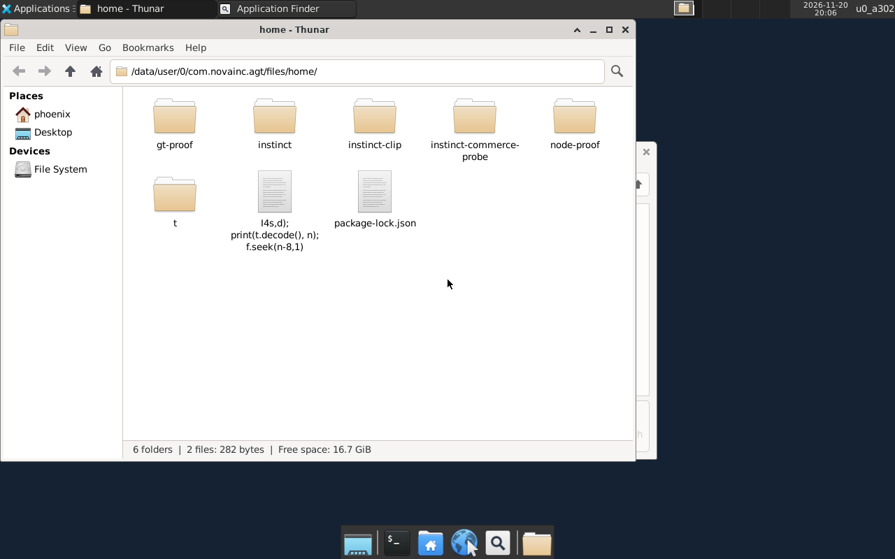

# AGT XFCE Desktop Add-on

A full XFCE desktop that runs on an Android phone inside [AGT](https://github.com/kilomene/Agt), packaged as an AGT add-on. Every agent hosted on the phone gets its **own private desktop space**, and the phone's owner can watch that desktop **live in a browser** through a one-time, view-only link. The viewer cannot click, type, or control anything; control stays with the agent doing the work.

Current version: **0.1.14** (see `addon.json`). Proven live on a Redmi 10C (Android 13) on 2026-11-20: desktop stable, viewing link held past 100 seconds, file manager and application finder windows open and visible.



## What it is for

Agents on AGT do real work on the phone: browsing, testing web apps, running tools. Some of that work is visual. This add-on gives each agent a real Linux desktop (XFCE on a virtual X server) so visual work happens in real windows, and gives the owner a window into it: when an agent opens its desktop, the owner receives a link like

```
https://x-agt.novamail.store/<token>
```

Opening it shows the agent's desktop, live, in any browser. When the agent finishes and closes the session, the link dies.

## How it works

```
Owner's browser
      |  https://x-agt.novamail.store/<token>
      v
Cloudflare tunnel  ->  gate (gate.py, phone localhost:18787)
      |  token checked against the live session record
      v
noVNC viewer (view_only=true)  ->  websockify  ->  x11vnc (-viewonly)
      |
      v
Xvfb virtual display :90+  <-  xfce4-session (xfwm4, panel, xfdesktop, Thunar)
```

Components, all running on the phone inside AGT's Linux layer:

- **Xvfb** - a virtual X server per agent session (1280x800x24). No physical screen is involved.
- **xfce4-session** - the real XFCE session: `xfwm4` window manager, `xfce4-panel`, `xfdesktop`, `xfsettingsd`, Thunar.
- **x11vnc** - serves the display over RFB, started with `-viewonly -nopw -localhost -noshm`, so the stream can be watched but never driven, and only from the phone itself.
- **websockify + noVNC** - the browser side of the stream (vendored under `share/xview/`).
- **gate.py** - a small Python gate on `127.0.0.1:18787`. It is the only part the tunnel reaches. A token URL redirects to that session's noVNC viewer; the websocket is spliced to that session's websockify port; everything else, including bad tokens, gets a 404.

### Per-agent spaces

Each agent gets its own space under `addons/xfce/spaces/<agent>/`: its own `HOME`, `.config`, `.cache`, `.local/share`, and `Desktop`. The file manager opens on the agent's own home folder. One agent's desktop never shows another agent's files, the phone's main storage, or other apps, the same isolation rule as AGT's per-agent filesystem and Vault.

Sessions are allocated slots (max 20): display `90 + slot`, VNC port `5990 + slot`, websockify port `6080 + slot`. The viewing token (10 characters) is minted on the phone by the session runner at start time. It is never sent in a job payload or typed anywhere; `agt-xfce link` reads it back from the phone's session record.

## Layout of this repository

```
addon.json                  the add-on manifest (id, name, version, entry point)
bin/agt-xfce                session control: start / link / status / close
bin/websockify              launcher wrapper for the vendored websockify
share/xview/gate.py         the token gate described above
share/xview/session_run.py  starts and supervises one agent's desktop stack
share/xview/websockify/     vendored websockify 0.12.0 (Python)
share/xview/web/            vendored noVNC 1.4.0 web client
etc/                        shipped defaults: fonts, XDG and xfconf settings
share/fontconfig/           fontconfig configuration snippets (conf.avail)
launcher/                   the two AGT deployments that run the add-on
build/                      from-source build scripts for the whole X/XFCE stack
tools/make_addon.py         packages the add-on tree into the installable zip
docs/                       proof screenshot
```

The compiled binaries themselves (Xorg, GTK, XFCE, about 70 packages) are not in git; they are built from source with the scripts in `build/` and packaged into the installable zip. See **Building** below.

## Installing

The add-on installs through AGT's add-on system, never by hand:

1. Package the tree: `python3 tools/make_addon.py` produces `xfce-<version>.zip` with a sha256.
2. Host the zip at any HTTPS URL.
3. Install it with an `addon_install` job (owner or main agent only; ordinary agents can list add-ons but can never install, change, or remove one), or from the AGT console with the built-in `agt-addon` tool.
4. Deploy the two launcher deployments from `launcher/`:
   - `xview-gate` runs `gate.sh` (the token gate, one per phone).
   - `xfce-<agent>` runs `session.sh <agent>` (one per agent that needs a desktop).

Updates are remove-then-install: `addon_remove` followed by `addon_install`. Removing the add-on wipes the desktop spaces, so sessions start fresh after an update.

## Using it

From any admitted agent's shell on the phone (the add-on's `bin/` is on `PATH`):

```
agt-xfce start  --agent <slug>   # prints the deployment payload for the session
agt-xfce link   --agent <slug>   # prints the live viewing URL for the owner
agt-xfce status --agent <slug>   # session state
agt-xfce close  --agent <slug>   # ends the session; the link stops working
```

Visual programs an agent runs (a browser, an image tool, any X client) open as windows on that agent's own display, so they are fully visible in the owner's live view while the agent uses them.

## Building

Everything is compiled from upstream source for Android's bionic libc on aarch64. Nothing is taken from any other project's packages; the compiled-in prefix is AGT's own:

```
XPREFIX = /data/data/com.novainc.agt/files/addons/xfce
```

Toolchain: Android NDK r28 clang, target `aarch64-linux-android26`. The build runs in four tranches, one script each in `build/`:

| Script | Contents |
|---|---|
| `build-xstack.sh` | X libraries: xcb, X11, Xext, Xrender, xtrans, pixman, fontconfig, freetype and friends |
| `build-xstack2.sh` | xorg-server 21.1.13 (Xvfb only), x11vnc 0.9.16, xkbcomp, websockify/noVNC vendoring |
| `build-gtk.sh` | glib, GTK 3, and the GNOME-side libraries (incl. libICE and libSM) |
| `build-xfce.sh` | XFCE 4.18: xfwm4, xfdesktop, xfce4-panel, xfce4-session, Thunar, xfce4-settings, xfce4-appfinder, plus the elementary-xfce icon theme rendered to PNG |

`build/fix-needed-paths.py` repairs absolute `DT_NEEDED` entries left by libraries without a SONAME (run it over the staged tree before packaging; only `DT_NEEDED` strings are rewritten).

## Android platform notes (the hard part)

A stock X/XFCE stack assumes a normal Linux system. Android's app sandbox breaks several of those assumptions, and each one had to be found and fixed at the root. These are documented here so nobody has to rediscover them:

- **There is no `/tmp`.** Xorg hardcodes `/tmp` for its lock file, and xtrans/libxcb hardcode `/tmp/.X11-unix`. The stack is built with those paths moved into the add-on's own `var/` directory, and the session runner creates `var/.X11-unix`, `var/.ICE-unix`, and `var/run` (the session D-Bus socket lives there too).
- **Hard links are denied** everywhere in app storage (F2FS with inline encryption). The X server's lock file uses `link()`, which fails; it is patched to claim the lock with `rename()` instead. libICE has the same bug in its authority-file lock; it is patched to fall back to an atomic `open(O_CREAT | O_EXCL)` when `link()` is refused, which has the same test-and-set semantics.
- **The seccomp filter kills forbidden syscalls with SIGSYS**, even harmless-looking ones. `setuid`/`setgid` (called by the X server's keyboard helpers before running `xkbcomp`) are compiled out. SysV shared memory (`shmget`) is likewise fatal: the X server is started with the MIT-SHM extension disabled (`-extension MIT-SHM`) and x11vnc with `-noshm`, so no client ever attempts it. With MIT-SHM off, clients fall back to plain X protocol and everything works.
- **XDG directories must be set explicitly.** The session exports `XDG_DATA_DIRS` and `XDG_CONFIG_DIRS` pointing at the add-on, or GTK finds no icon theme, fontconfig finds no fonts (text renders as empty boxes), and the shipped xfconf defaults never apply.
- **No SVG pixbuf loader.** The phone's gdk-pixbuf has a PNG loader and a GIF loader only, so SVG icons can never render. The elementary-xfce theme is therefore shipped pre-rendered to PNG at every size.
- **Window manager compositing stays off** by shipped xfconf default (`/general/use_compositing = false`): with no GPU and no SHM, the compositor path makes `xfwm4` exit believing another compositing manager owns the screen.
- **The viewer gate must not time out idle splices.** A static desktop sends nothing for minutes at a time; the gate's byte splice waits indefinitely and only closes when a side actually closes.

## Version history (short)

- **0.1.14** - gate idle-splice fix; compositing off as a shipped default.
- **0.1.13** - XDG data/config dirs in the session; DejaVu fonts resolve; elementary-xfce PNG icon theme; Thunar window defaults.
- **0.1.12** - MIT-SHM disabled on the X server (fixes `xfwm4` dying by SIGSYS on `shmget`, found by ptrace).
- **0.1.11** - libICE authority-lock fallback (desktop clients could not authenticate to the session manager before this).
- **0.1.9 / 0.1.10** - session D-Bus `var/run`; iceauth path scrubbed of build-machine paths.
- **0.1.8** - x11vnc `-noshm`; first fully live session.
- **0.1.4 to 0.1.7** - `/tmp` paths moved, X lock by rename, `setuid`/`setgid` compiled out, websockify module entry point.
- **0.1.0** - first package: full stack built from source, session machinery, token gate.

## License

MIT. Copyright (c) 2026 Zenas Ayansipe Olatunde and Nova Inc. See `LICENSE`.

Vendored components keep their own licenses: noVNC (MPL-2.0), websockify (LGPL-3.0), and the upstream X.org, GTK, and XFCE sources the build scripts compile.
